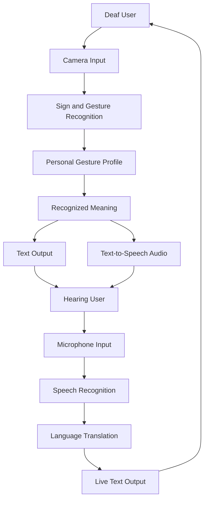

# MUDRA — Breaking Communication Barriers

**An AI-powered, two-way communication platform connecting deaf and hearing individuals.**

MUDRA aims to make everyday conversations more accessible by translating sign language into text and speech, while converting spoken conversations into readable text in real time.

## The Problem

Communication between deaf and hearing individuals can be challenging when both people do not understand each other's primary communication method.

- Hearing individuals may not understand sign language.
- Deaf individuals may not be able to access spoken conversations.
- Writing messages back and forth can interrupt natural, real-time interaction.
- Existing communication methods may not support an individual's personal gestures.

## Our Solution

MUDRA creates a two-way communication bridge using a camera and microphone.

### 1. Sign Language to Text and Speech
- Captures signs through the device camera.
- Uses AI-powered visual recognition to interpret signs and gestures.
- Displays the recognized meaning as text.
- Converts the recognized text into spoken audio for the hearing person.

### 2. Speech to Text
- Captures the hearing person's speech through a microphone.
- Converts speech into text.
- Displays the transcription for the deaf user.

### 3. Multilingual Communication
MUDRA aims to support communication across language preferences by translating recognized speech into the user's preferred written language.

### 4. Personalized Gesture Vocabulary
Not every individual communicates using exactly the same gestures.

MUDRA aims to let users:
- Record their own custom gestures.
- Assign meanings to those gestures.
- Save and manage a personal gesture vocabulary.
- Add, edit or remove gestures as needed.

### 5. Gesture Profile Sharing
Users can share their authorized personal gesture vocabulary through a unique sharing code.

A conversation partner can:
1. Open MUDRA on their own device.
2. Enter the shared code.
3. Access the permitted gesture profile.
4. Use their camera to communicate with the user using both standard and personalized gestures.

The profile owner should retain control over access and be able to revoke sharing permissions.

## How MUDRA Works

## Core Features

| Feature | Description |
|---|---|
| Sign Recognition | Interprets sign language and gestures through camera input |
| Speech Recognition | Converts spoken language into text |
| Text-to-Speech | Converts recognized signs into spoken audio |
| Multilingual Support | Supports translation into preferred written languages |
| Custom Gestures | Allows users to create personalized gesture vocabularies |
| Profile Sharing | Enables authorized sharing through unique codes |
| Two-Way Communication | Supports communication in both directions |

## Technology & Architecture

MUDRA is designed around the following technical capabilities:

- **Computer Vision:** Visual recognition of signs and gestures.
- **Speech Recognition:** Conversion of spoken audio into text.
- **Natural Language Processing:** Language interpretation and translation.
- **Text-to-Speech:** Audio generation from recognized text.
- **Personalization:** User-specific gesture vocabulary and profile management.
- **Web Technologies:** Camera and microphone access through a web application.

*The final frameworks, models, databases and infrastructure will be documented as the implementation is finalized.*

## Potential Impact

MUDRA aims to:

- Reduce communication barriers between deaf and hearing individuals.
- Make everyday interactions more accessible.
- Support personalized communication beyond predefined sign vocabularies.
- Enable users to carry and share their gesture vocabulary across communication partners.
- Encourage more inclusive communication in educational, social and public environments.

## Project Team

**Team ETHOS**

- Aviral Singh
- Anant Singh
- Drashya Kumar Singh
- Arsh Bhardwaj

## Hackathon

**13TH PROTOCOL: AN AI HACKATHON 2026**  
Voyager Coding Club, KCC ITM

---

**MUDRA — Because communication should be accessible to everyone.**
